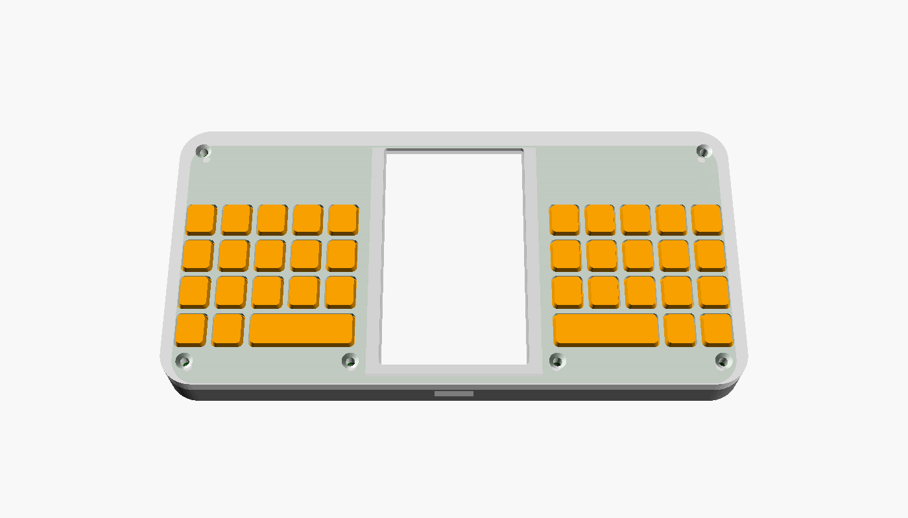

# DigitalPN — 손안의 디지털 타자기

메모를 쓰고 내보내는 일만 하는 휴대용 기기의 하드웨어·소프트웨어 설계.
스마트폰보다 조금 작고(142 × 70 × 12 mm), 가로로 쥐고 두 엄지로 친다.
케이스는 3D 프린팅용 곡선형으로, 주머니용 얇은 형(서포트 불필요)과 손잡이형 두 가지가 있다.



## 설계의 핵심 결정

| 결정 | 이유 |
|---|---|
| **가로 그립, 화면을 가운데 두고 키를 좌우로 분할** | 엄지가 닿아야 하는 가로 거리가 최대 46 mm로 줄어든다. 손을 고쳐 쥐지 않고 모든 키에 닿는다. |
| **키 간격 9.0 × 10.0 mm의 택타일 스위치 39키** | 엄지 접촉 폭(약 10 mm)과 같은 크기라 옆 키를 함께 누르는 오타가 줄고, 눌린 감각이 있어 화면만 보고 칠 수 있다. 간격과 묶음 위치는 [타자 시뮬레이션](docs/simulation.md)으로 정했다. |
| **곡선 행** (안쪽 열은 낮게, 바깥 열은 높게) | 엄지가 손을 움직이지 않고 닿는 영역은 뿌리 관절을 중심으로 한 띠 모양이다. 행을 그 띠에 맞추면 평균 관절 부담이 19% 줄어든다. |
| **어깨 버튼 2개(검지)로 Shift·기호 전환** | 쌍자음·숫자·기호를 칠 때 엄지가 글자 키를 떠나지 않는다. |
| **두벌식 그대로** (왼손 자음, 오른손 모음) | 한글은 자음·모음이 번갈아 나와서 두 엄지가 자연스럽게 교대한다. 새 배열을 익힐 필요가 없다. |
| **반사형 메모리 LCD** (2.7", 세로) | 전자종이와 달리 키 입력이 즉시 보이고, 백라이트 없이 상시 표시되며 전력이 거의 들지 않는다. |
| **항목 단위 JSONL 추가 전용 저널, 부모-자식 트리** | 한 줄이 곧 한 항목이라 전원이 끊겨도 안전하고, 그대로 전송·검색·임베딩 단위가 된다. 탭으로 하위 항목을 만들면 `parent`로 이어져 저장된다. |
| **ESP32-S3 한 개로 BLE·Wi-Fi·USB** | 앱 전송(BLE), 서버 전송(HTTPS), USB 드라이브로 파일 꺼내기를 같은 레코드 형식으로 처리한다. |
| **PCB 한 장이 "코어", 케이스는 껍데기** | 코어의 치수 계약만 지키면 케이스·키캡을 자유롭게 다시 만들 수 있다. |

속도·정확도는 엄지 관절 가동범위 모델로 시뮬레이션해 형태를 비교했다([결과](docs/simulation.md)). 사람으로 실측한 값은 아직 없으며 [검증 계획](#검증-계획)의 0단계에서 확인한다.

## 문서

- [docs/hardware.md](docs/hardware.md) — 폼팩터 근거, 부품, 전력, 배치
- [docs/input.md](docs/input.md) — 키 배열, 레이어, 한글 조합, 입력 지연 설계
- [docs/firmware.md](docs/firmware.md) — 펌웨어 구조, 저장, 화면, 전원 관리
- [docs/data-and-sync.md](docs/data-and-sync.md) — JSON 레코드 형식과 BLE / Wi-Fi / USB 전송 규약
- [docs/case.md](docs/case.md) — 코어 인터페이스와 케이스 커스텀 방법
- [docs/simulation.md](docs/simulation.md) — 엄지 관절 모델 타자 시뮬레이션: 방법, 결과, 한계
- [docs/cost.md](docs/cost.md) — 생산 단가 추정 (시제품 / 1,000대 / 10,000대)

## 저장소 구성

```
schema/item.schema.json        항목 레코드 JSON Schema (v2)
schema/examples/sample.jsonl   예시 저널
hardware/case/dpn_core.scad    코어 인터페이스 치수 (케이스 설계의 기준)
hardware/case/case.scad        파라메트릭 기준 케이스 (앞판·뒷판·키매트·어깨 버튼)
firmware/core/hangul.[ch]      두벌식 한글 오토마타 (하드웨어 독립 C, 테스트 포함)
sim/                           타자 시뮬레이터 (엄지 운동학, 그립 최적화, 설계 탐색, 곡선 배열, 3D 영상)
docs/video/                    시뮬레이션 영상
```

```sh
make -C firmware/core test                                          # 한글 조합 테스트
openscad -D 'part="top"' -o top.stl hardware/case/case.scad         # 케이스 부품 STL
```

## 검증 계획

| 단계 | 만드는 것 | 확인하는 것 |
|---|---|---|
| 0. 타건 목업 | 기준 케이스 출력 + 스위치만 얹은 만능기판(또는 개발보드 + 키 매트릭스), USB 키보드로 동작. 분할형과 묶음을 붙인 형태 둘 다 | 키 간격·누름 압력·어깨 버튼에 검지가 닿는지. 10분 연습 뒤 분당 타수와 백스페이스 비율을 스마트폰 자판과 비교하고 시뮬레이션 계수를 보정 |
| 1. 개발보드 시제품 | ESP32-S3 개발보드 + 메모리 LCD + 키 PCB | 키→화면 지연, 한글 조합, 저널 기록, 전원 차단 복구 |
| 2. 코어 PCB v0.1 | 본 설계의 일체형 PCB | 전류 소모 실측, 안테나 성능, 충전 |
| 3. 전송 | BLE 앱(또는 Web Bluetooth 페이지), HTTPS 수신 서버 예제 | 끊김 뒤 이어받기, 중복 없는 전송 |

## 아직 확인되지 않은 것

- 본문의 부품 번호와 치수(특히 디스플레이 전원 전압, 스위치 누름 압력)는 발주 전에 데이터시트로 다시 확인해야 한다.
- 전력·배터리 수명은 계산값이며 실측하지 않았다.
- 타자 시뮬레이션은 사람으로 검증하지 않은 모델이다. 형태 간 차이가 2% 안팎인 선택(분할형 대 붙임형)은 목업 실측으로 정해야 한다.
- 기준 케이스는 OpenSCAD에서 오류 없이 렌더링되는 것까지만 확인했고 출력·조립은 해 보지 않았다. 그립감과 주머니 수납성은 치수로 설계한 것이며 손으로 확인하지 않았다.
- PCB 회로도·아트워크, 기기 펌웨어 본체, 수신 앱·서버는 아직 없다. 구현된 코드는 한글 오토마타뿐이다.
