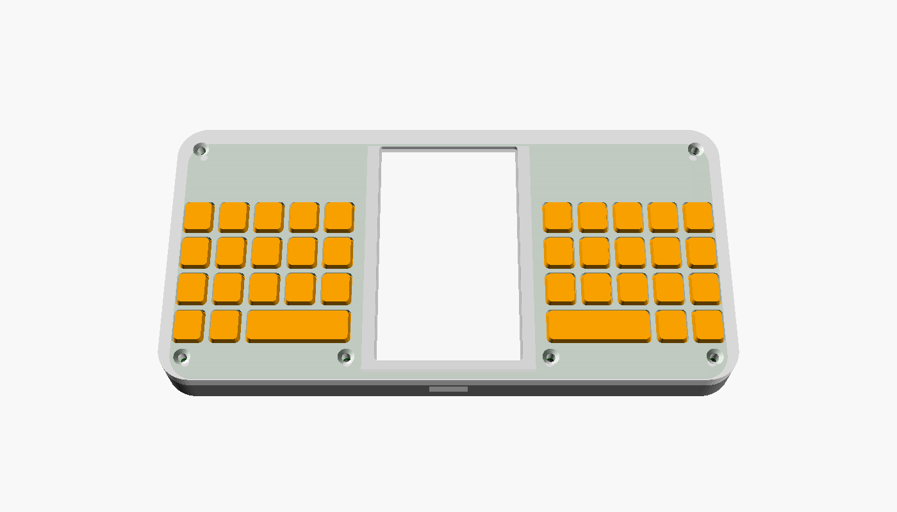
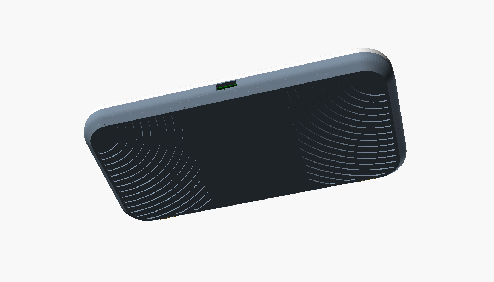
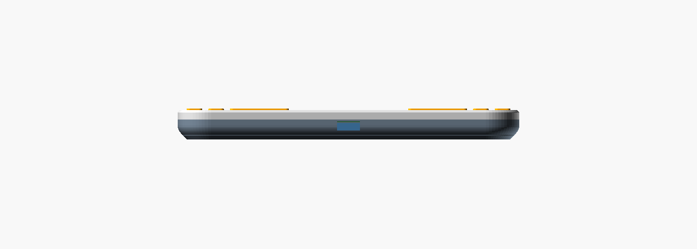
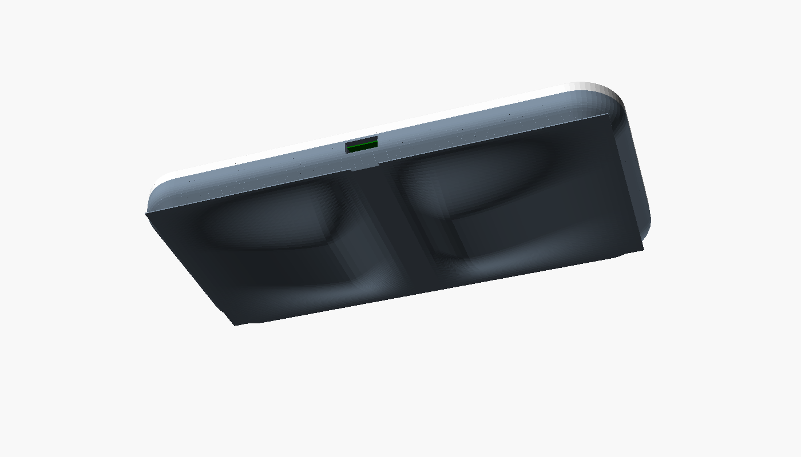
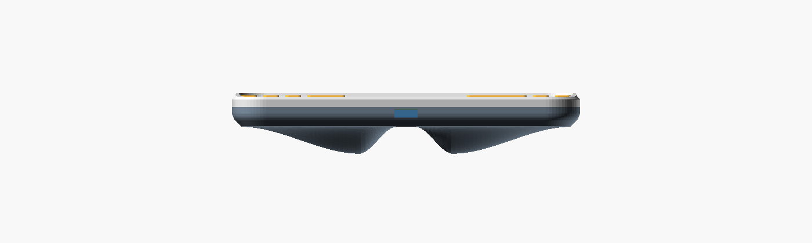
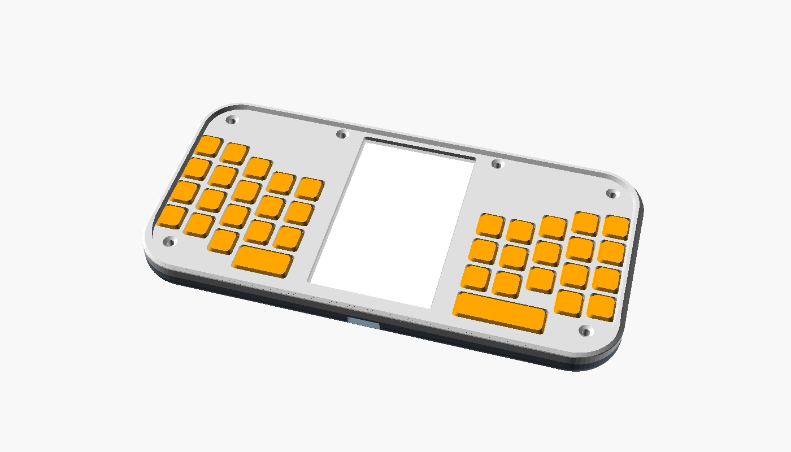
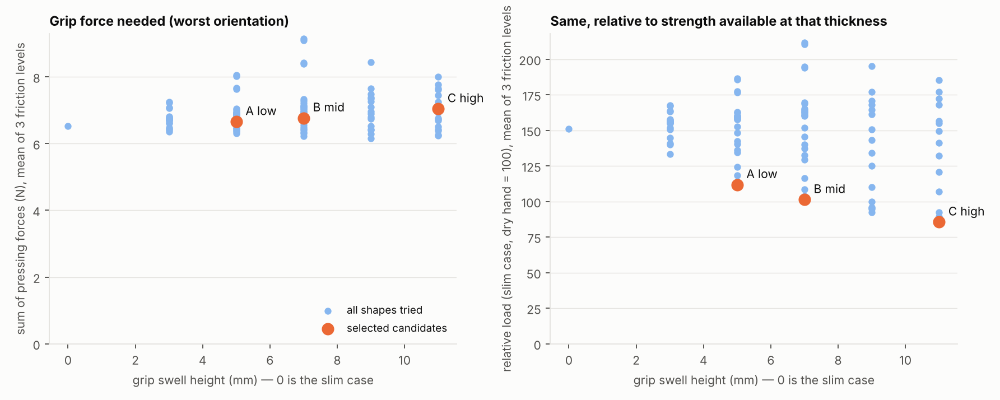

# 케이스 커스텀

## 1. 원칙: 코어와 껍데기를 나눈다

전자 부품은 모두 PCB 한 장(코어)에 있다. 케이스는 코어를 감싸는 껍데기일 뿐이고 배선도, 케이스에 붙는 부품도 없다. 따라서 케이스를 새로 만들 때 지켜야 하는 것은 치수 계약 하나뿐이다.

계약은 [`hardware/case/dpn_core.scad`](../hardware/case/dpn_core.scad)에 변수로 정리되어 있다. 코어 인터페이스 버전(현재 v0.5)이 같으면 어떤 케이스든 어떤 코어와도 맞는다.

| 케이스가 맞춰야 하는 것 | 값 |
|---|---|
| PCB 외곽 | 138 × 66 mm, R12, 두께 1.0 |
| 나사 | M2 × 6곳: (±61, ±26), (±25, +29). 앞에서 조여 뒷판 인서트에 체결 |
| 디스플레이 창 | 중심 (0, 0), 표시 영역 35.28 × 58.8 |
| 키 중심 | x = ±(28 + 9·i), y = 9 − 10·r + col_dy[i], col_dy = [−5, −5, −1, +3, +4] (곡선 행) |
| 맨 아랫행 | 오른쪽: 스페이스 3칸 + 단독 2칸. 왼쪽: 스페이스 2칸 + 탭 + 단독 2칸 (좌우 비대칭) |
| 스위치 높이 | PCB 앞면에서 2.0 |
| USB-C 구멍 | 아래 모서리 x = 0, 9.4 × 3.6 |
| 어깨 버튼 구멍 | 위 모서리 x = ±50, 10 × 3.4 |
| 뒷면 깊이 | PCB 뒷면에서 5.6 이상 |
| 안테나 금지 구역 | 뒷면 x 30~46, y 25~33 부근에 금속·두꺼운 손잡이 금지 |

## 2. 기준 케이스

[`hardware/case/case.scad`](../hardware/case/case.scad) — 손에 쥐는 느낌과 주머니 수납을 기준으로 한 곡선형이며, FDM 프린터에서 서포트 없이 출력되도록 만들었다.





### 모양

| 요소 | 값 | 이유 |
|---|---|---|
| 평면 모서리 | R14 | 손바닥과 주머니 입구에 걸리는 뾰족한 곳을 없앤다 |
| 뒷면 가장자리 | 6 mm 높이에 걸쳐 4 mm 안으로 말려 올라감 | 엄지 뿌리(물갈퀴)에 닿는 아래 모서리가 둥글어 오래 쥐어도 배기지 않는다. 가장자리 두께가 5.3 mm로 얇아져 주머니에 미끄러져 들어간다 |
| 뒷면 가운데 | 평면 (약 134 × 62 mm) | 책상에 놓고 칠 때 흔들리지 않고, 출력할 때 바닥에 붙는 면이 된다 |
| 뒷면 손가락 자리 | 깊이 0.6 mm의 동심 호 홈, 좌우 | 튀어나온 것 없이 미끄럼을 막는다. 홈은 아래 바깥 모서리를 중심으로 휘어 손가락이 감기는 방향과 직각이다 |
| 앞면 가장자리 | 1 mm 모따기 | 앞판을 바닥에 붙여 출력할 때 코끼리 발 현상을 감춘다 |
| 키캡 | 앞판 위로 0.6 mm, 윗면을 좁혀 볼록하게 | 주머니에서 덜 눌리고, 손끝으로 키 경계를 찾기 쉽다 |
| 디스플레이 | 앞판보다 0.8 mm 안쪽 | 주머니 속 물건에 직접 긁히지 않는다 |
| 어깨 버튼 | 케이스 곡면과 같은 높이 | 튀어나오지 않는다 |

전체 142 × 70 × 12.3 mm. 튀어나온 부분은 키캡 0.6 mm뿐이다. 주머니 안에서 키가 눌리는 것은 케이스만으로 막을 수 없으므로 펌웨어의 키 잠금(대기 상태에서는 메뉴 키를 길게 눌러야 깨어남)과 함께 쓴다.

### 출력

| 부품 | `part` 값 | 재질 | 놓는 방향 |
|---|---|---|---|
| 앞판 | `top` | PLA / PETG | 앞면을 바닥에 |
| 뒷판 | `bottom` | PLA / PETG | 뒷면을 바닥에 |
| 키매트 좌·우 | `keymat_l`, `keymat_r` | TPU 95A 권장 | 키캡 윗면을 바닥에 |
| 어깨 버튼 캡 | `shoulder` × 2 | PLA / PETG | 넓은 턱을 바닥에 |

```sh
cd hardware/case
for p in top bottom keymat_l keymat_r shoulder; do
  openscad -D "part=\"$p\"" -o "$p.stl" case.scad
done
```

- **서포트 불필요.** 뒷면 가장자리는 바닥에서 45° 직선으로 2.5 mm 올라간 뒤 45°에서 시작하는 원호로 수직 벽에 이어진다. 어느 지점도 45°보다 눕지 않는다.
- 손가락 홈은 폭 1.2 mm라 첫 층 위에서 짧은 브리지로 메워진다.
- 권장 설정: 노즐 0.4 mm, 적층 0.2 mm(가장자리 곡면을 매끄럽게 하려면 0.12~0.16 mm), 외벽 3줄, 채움은 거의 필요 없음(벽이 얇아 대부분 외벽).
- 앞판과 뒷판의 바깥 면은 출력판의 질감이 그대로 남는다. 무늬 있는 PEI 판을 쓰면 손에 닿는 면이 미끄럽지 않다.
- 뒷판 보스 6곳에 M2 열압입 인서트(바깥지름 3.2 mm, 길이 3~4 mm)를 넣는다.
- 맞춤이 빡빡하면 `clearance`(PCB와 벽 사이)와 `cap_gap`(키캡과 구멍 사이)을 0.1 mm씩 키운다.
- SLS·MJF·레진으로 뽑을 때는 `process = "sls"`로 바꾸면 뒷면 가장자리가 완전한 원호가 된다(FDM에서는 서포트가 필요한 모양).

조립: 뒷판에 인서트 → 배터리 → 코어 → 어깨 캡 → 키매트를 스위치 위에 올림 → 앞판 → M2 × 6 접시머리 나사 6개.

키매트를 일체형으로 한 이유는 키 간격이 9 mm라서다. 키캡마다 빠짐 방지 턱을 두면 앞판 살이 0.6 mm밖에 남지 않는다. 시트로 이으면 앞판 살을 1.2 mm로 유지하면서 키캡도 고정된다.

이 케이스는 모델이 오류 없이 만들어지는 것까지 확인했고 실제로 출력해 보지는 않았다.

## 3. 손잡이형 (`style = "grip"`)

얇은 기본형은 그대로 두고, 쥐는 느낌을 앞세운 변형을 같은 파일에 넣었다. 코어와 키매트, 어깨 캡은 공통이고 앞판과 뒷판만 다르다. 융기의 모양은 [한 손 쥐기 시뮬레이션](#한-손-쥐기-시뮬레이션)으로 골랐다.

| 후보 B 뒷면 | 후보 C 옆모습 |
|---|---|
|  |  |



### 모양

- **뒷면 융기**: 좌우에 하나씩, 높이장(heightfield)으로 만든 한 덩어리 곡면이다. 가장자리 곡면이 끝나는 곳에서 기울기 0으로 솟기 시작해 옆 모서리에서 52 mm 안쪽의 마루까지 완만하게 오르고, 15 mm에 걸쳐 내려와 다시 기울기 0으로 뒷면에 닿는다. 위아래 끝도 22 mm에 걸쳐 사그라든다. 모든 경계가 접선으로 이어져 본체와의 사이에 꺾인 선이 없다.
- **앞면 테두리 턱**: 높이 1.4 mm, 좌·우·위 세 변. 한 손으로 쥘 때 엄지 두덩이 밀리지 않게 받치고, 키캡보다 높아 주머니나 가방에서 키를 가린다. 아래 변은 엄지가 넘어 들어오는 길이라 비웠다.

### 후보

| 후보 | `grip_variant` | 융기 높이 | 가장 두꺼운 곳 | 추가 무게(추정) | 쥐는 부담 (얇은 기본형 = 100) |
|---|---|---|---|---|---|
| 얇은 기본형 | — | 0 | 12.3 mm | — | 100 |
| A 낮음 | `"A"` | 5 mm | 17.3 mm | +6 g | 74 |
| **B 중간** (기본값) | `"B"` | 7 mm | 19.3 mm | +8 g | 67 |
| C 높음 | `"C"` | 11 mm | 23.3 mm | +12 g | 57 |

가장자리 두께는 세 후보 모두 5.3 mm 그대로다. B를 기본값으로 둔 것은 부담 감소의 대부분을 얻으면서 겉옷 주머니에 들어가는 두께이기 때문이다. 높을수록 쥐기는 편하고 넣고 다니기는 불편하다.

### 한 손 쥐기 시뮬레이션

[`sim/grip.py`](../sim/grip.py). 기기의 한쪽 끝을 한 손으로 쥐고, 기기를 어떤 자세로 들든(중력 방향 26가지) 힘과 돌림힘의 평형을 이루는 데 필요한 **누르는 힘의 합이 가장 작은 해**를 구한다.

- 접촉점 7개: 엄지(앞면), 엄지 뿌리 쪽 손바닥(옆 모서리), 손바닥(뒷면), 손가락 끝 넷. 각 접촉은 면을 누르는 힘과 마찰력만 낼 수 있다.
- 손은 가장 편한 쥐는 법을 스스로 고른다: 손가락 끝의 위치(손 길이의 0.11~0.31배 안쪽), 손바닥 위치, 세로 위치, 그리고 네 손가락을 모두 뒷면에 둘지 검지를 위 모서리에 걸고 새끼손가락으로 아래 모서리를 받칠지.
- 손 크기 3종(160 / 178 / 196 mm), 마찰 3종(마른 손 0.5, 보통 0.3, 미끄러운 손 0.15).
- 융기 모양 104가지: 높이 3~11 mm, 마루 위치 16~58 mm, 안쪽 비탈 폭 7~15 mm, 손가락 골 유무.



**결과**

1. **필요한 힘 자체는 융기로 줄지 않는다.** 기기가 가벼워서(약 95 g) 최악의 자세에서도 누르는 힘의 합이 4~10 N이고, 후보들은 얇은 기본형보다 2~8% 더 든다(융기의 무게와 기울어진 접촉면 때문). 왼쪽 그림.
2. **끝 가까이에 둔 융기는 불리하다.** 이전 설계처럼 마루를 모서리에서 16 mm에 두면 손가락 끝(모서리에서 48~61 mm에 놓임)이 융기를 지나쳐 버리고, 손바닥은 비탈에 얹혀 기기를 밖으로 밀어낸다. 필요한 힘이 7% 늘었다.
3. **마루는 손가락 끝이 놓이는 자리에 와야 한다.** 마루 위치 52 mm, 안쪽 비탈 폭 15 mm에서 가장 좋았다. 그보다 안쪽(58 mm)은 작은 손이 닿지 못한다.
4. **손가락 골(가로 홈)은 효과가 일정하지 않다.** 손 크기에 따라 맞기도 어긋나기도 해서 평균 효과가 0에 가깝다. 채택하지 않았다.
5. **이점은 "쥐는 폭"에서 나온다.** 얇은 판을 집을 때보다 두꺼운 것을 감아쥘 때 낼 수 있는 힘이 크다. 필요한 힘을 그 두께에서 낼 수 있는 힘으로 나눈 값(쥐는 부담)은 A −26%, B −33%, C −43%다. 오른쪽 그림. 수평으로 한쪽 끝만 들고 있는 자세만 보면 마른 손 기준 −27%, −33%, −42%다.

**이 결과를 읽을 때**
- 5번은 가정에 기대고 있다. 쥐는 폭에 따른 힘의 여유를 "48 mm 부근에서 최대, 12 mm 판을 집을 때는 그 1/4 수준"이라는 종 모양 곡선으로 어림했다. 악력 연구의 일반적인 경향을 따른 것이지만 이 기기의 쥐는 자세로 측정한 값이 아니다. 이 가정을 빼면 융기의 이점은 없다(1번).
- 접촉점은 7개의 점이다. 실제 손은 면으로 감싸므로 융기가 손바닥을 채우는 느낌, 압력이 퍼지는 효과는 계산에 없다.
- 두 손으로 타자할 때 융기가 손가락을 방해하는지는 다루지 않았다. 타자 시뮬레이션은 엄지만 모델링한다.
- 사람이 쥐어 본 결과가 아니다. A·B·C를 모두 출력해 직접 비교하는 것을 전제로 한 후보군이다.

### 출력

| 부품 | 놓는 방향 | 서포트 |
|---|---|---|
| 손잡이형 뒷판 | 열린 쪽을 바닥에 (손에 닿는 곡면이 위) | 안쪽 바닥면 아래에 필요. 손에 닿는 면에는 서포트 자국이 남지 않는다 |
| 손잡이형 앞판 | 앞면을 바닥에 | 테두리 턱 때문에 앞면 아래에 필요 (또는 안쪽을 바닥에 두고 기둥 주변만) |

```sh
openscad -D 'style="grip"' -D 'grip_variant="B"' -D 'part="bottom"' -o gripB-bottom.stl case.scad
openscad -D 'style="grip"' -D 'part="top"' -o grip-top.stl case.scad
```

- 융기는 속이 찬 덩어리로 모델링되어 있다. 채움 10~15%로 뽑으면 가볍다(표의 추가 무게는 그 기준의 어림값).
- SLS·MJF로 뽑으면 서포트 문제가 없다.
- 책상에 놓으면 두 융기 위에 얹힌다.
- 손에 맞게 고치려면 `grip_variant = "custom"`으로 두고 `lump_custom = [높이, 마루 위치, 안쪽 비탈 폭, 골 깊이 비율]`을 바꾼다. `rim_h`는 앞면 턱 높이다.

## 4. 바꿔 볼 수 있는 것

`case.scad` 위쪽의 변수만 고쳐도 되는 것들:

| 변수 | 효과 |
|---|---|
| `cap_w`, `cap_h`, `cap_proud` | 키캡 크기와 돌출 높이 |
| `outer_r`, `wall`, `face_t`, `floor_t` | 외형 둥글기와 두께 |
| `back_edge`, `back_cham` | 뒷면 가장자리가 말려 올라가는 높이와 45° 구간. 키울수록 가장자리가 얇고 둥글어진다 |
| `grip`, `grip_depth`, `grip_pitch` | 뒷면 손가락 홈 켜기·깊이·간격 |
| `process` | `"fdm"`(45° 제한) 또는 `"sls"`(완전한 원호) |
| `mat_t`, `nub_d` | 키매트 탄성과 누름 돌기 |
| `col_dy` (`dpn_core.scad`) | 열별 세로 이동량. 자기 손에 맞는 곡선으로 바꾸거나 전부 0으로 두어 평면 격자로 만들 수 있다. 바꾸면 PCB의 스위치 위치도 함께 바뀌어야 한다. |
| `win_margin` | 화면 창 여유 |

모델을 고쳐서 할 수 있는 것들:

- **키캡 모양**: 가운데가 볼록하거나 오목한 캡, 기준 키 돌기, 행마다 다른 기울기. `keymat()`의 `hull()` 부분만 바꾸면 된다.
- **낱개 키캡 + 금속판**: 키매트 대신 얇은 판과 개별 캡을 쓰는 구성. 스위치 위치와 높이만 지키면 된다.
- **뒷판 교체**: 더 큰 배터리용 두꺼운 뒷판, 스트랩 고리, 거치용 자석 자리. 뒷면 깊이와 안테나 금지 구역만 지킨다.
- **다른 제작 방식**: 외곽과 구멍 위치가 2D로 정의되어 있어 아크릴·목재 적층(레이저 절단)이나 CNC 알루미늄으로도 만들 수 있다. 금속 케이스는 안테나 구역을 반드시 비워야 한다.
- **각인**: 키매트 윗면에 음각을 넣거나, 무각으로 출력하고 스티커를 쓴다.

## 5. 코어를 바꾸는 경우

키 간격이나 디스플레이 위치처럼 계약에 있는 값을 바꾸면 인터페이스 버전을 올리고 `dpn_core.scad`와 [hardware.md](hardware.md)의 표를 함께 고친다. 기준 케이스는 이 파일의 변수에서 모든 치수를 유도하므로 값을 바꾸면 따라 바뀐다.
