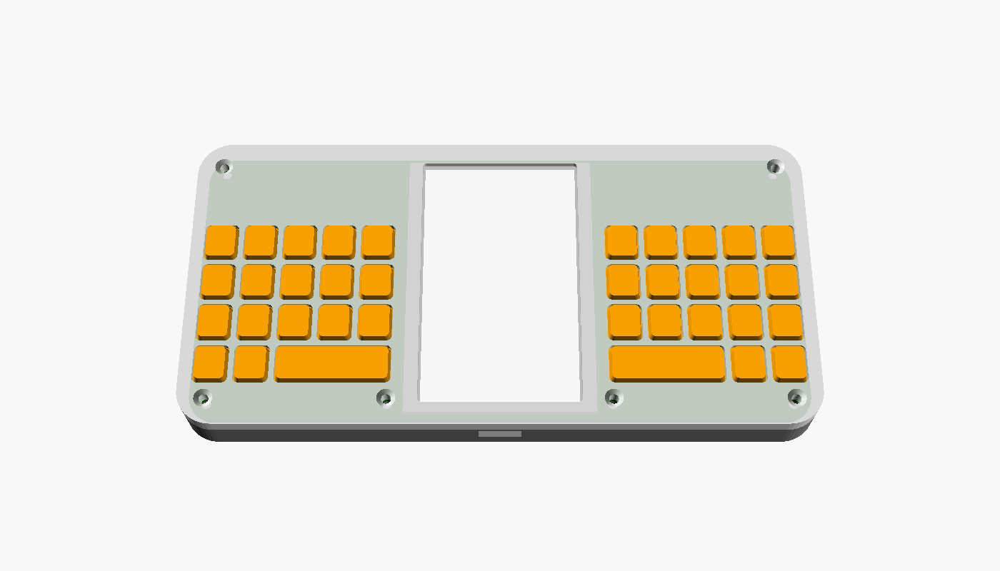
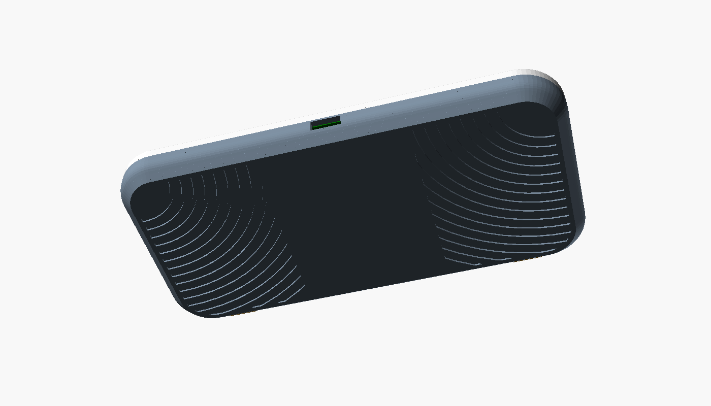
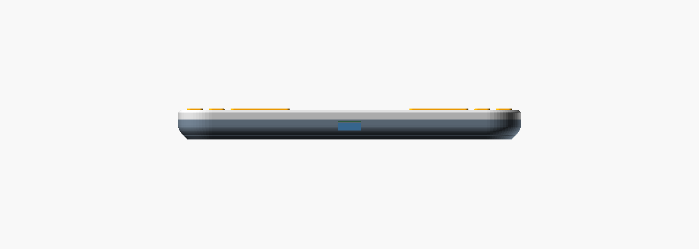
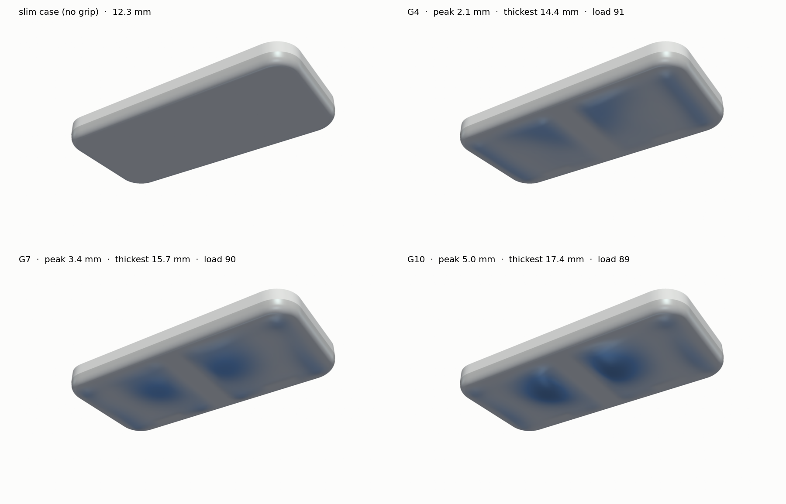
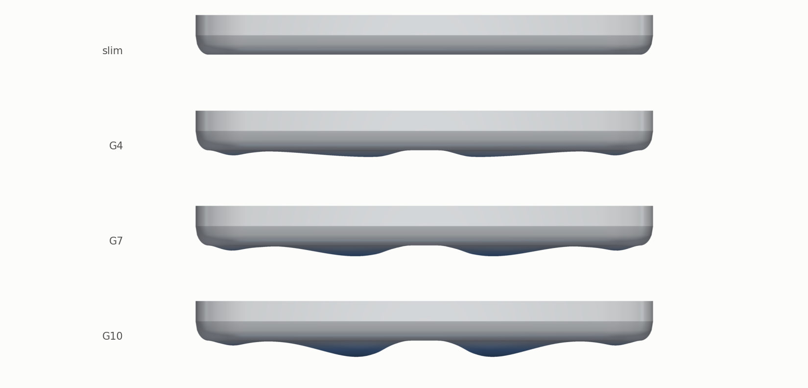
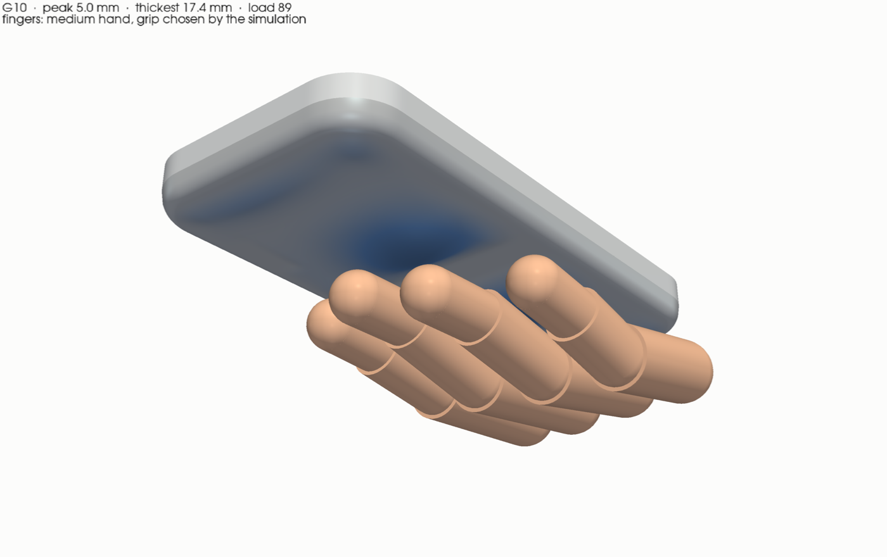
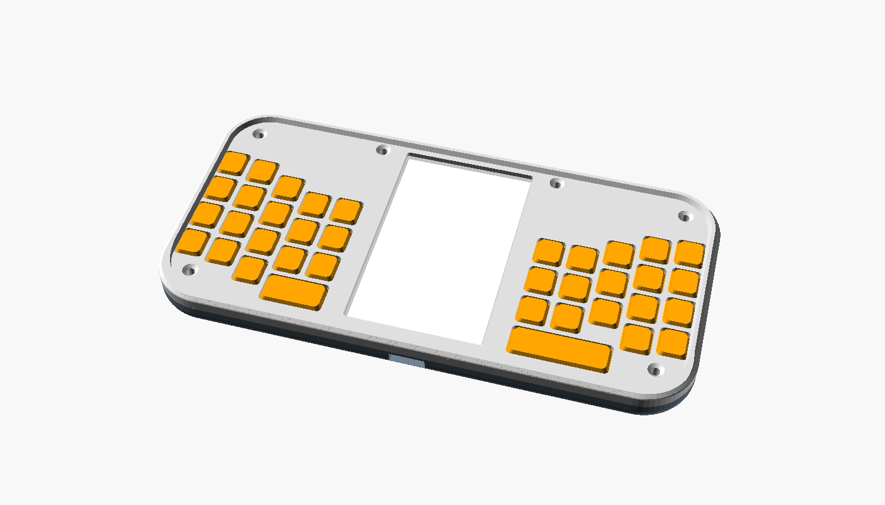
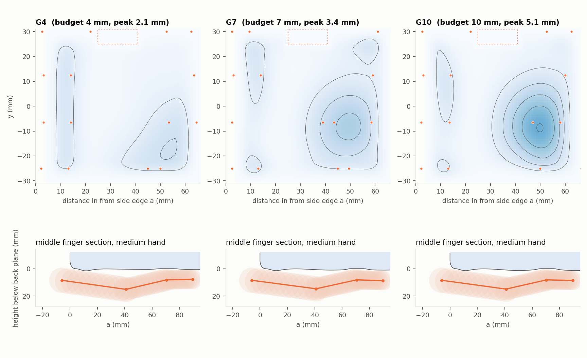
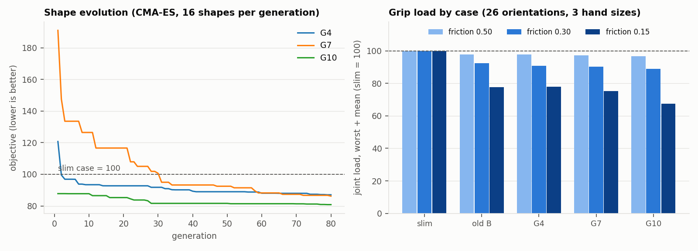

# 케이스 커스텀

## 1. 원칙: 코어와 껍데기를 나눈다

전자 부품은 모두 PCB 한 장(코어)에 있다. 케이스는 코어를 감싸는 껍데기일 뿐이고 배선도, 케이스에 붙는 부품도 없다. 따라서 케이스를 새로 만들 때 지켜야 하는 것은 치수 계약 하나뿐이다.

계약은 [`hardware/case/dpn_core.scad`](../hardware/case/dpn_core.scad)에 변수로 정리되어 있다. 코어 인터페이스 버전(현재 v0.5)이 같으면 어떤 케이스든 어떤 코어와도 맞는다.

| 케이스가 맞춰야 하는 것 | 값 |
|---|---|
| PCB 외곽 | 138 × 66 mm, R12, 두께 1.0 |
| 나사 | M2 × 6곳: (±61, ±26), (±25, +29). 앞에서 조여 뒷판 인서트에 체결 |
| 디스플레이 창 | 중심 (0, 0), 표시 영역 35.28 × 58.8 |
| 키 중심 | x = ±(28 + 9·i), y = 9 − 10·r + col_dy[i], col_dy = [−5, −5, −1, +3, +4] (곡선 행) |
| 맨 아랫행 | 오른쪽: 스페이스 3칸 + 단독 2칸. 왼쪽: 스페이스 2칸 + 탭 + 단독 2칸 (좌우 비대칭) |
| 스위치 높이 | PCB 앞면에서 2.0 |
| USB-C 구멍 | 아래 모서리 x = 0, 9.4 × 3.6 |
| 어깨 버튼 구멍 | 위 모서리 x = ±50, 10 × 3.4 |
| 뒷면 깊이 | PCB 뒷면에서 5.6 이상 |
| 안테나 금지 구역 | 뒷면 x 30~46, y 25~33 부근에 금속·두꺼운 손잡이 금지 |

## 2. 기준 케이스

[`hardware/case/case.scad`](../hardware/case/case.scad) — 손에 쥐는 느낌과 주머니 수납을 기준으로 한 곡선형이며, FDM 프린터에서 서포트 없이 출력되도록 만들었다.





### 모양

| 요소 | 값 | 이유 |
|---|---|---|
| 평면 모서리 | R14 | 손바닥과 주머니 입구에 걸리는 뾰족한 곳을 없앤다 |
| 뒷면 가장자리 | 6 mm 높이에 걸쳐 4 mm 안으로 말려 올라감 | 엄지 뿌리(물갈퀴)에 닿는 아래 모서리가 둥글어 오래 쥐어도 배기지 않는다. 가장자리 두께가 5.3 mm로 얇아져 주머니에 미끄러져 들어간다 |
| 뒷면 가운데 | 평면 (약 134 × 62 mm) | 책상에 놓고 칠 때 흔들리지 않고, 출력할 때 바닥에 붙는 면이 된다 |
| 뒷면 손가락 자리 | 깊이 0.6 mm의 동심 호 홈, 좌우 | 튀어나온 것 없이 미끄럼을 막는다. 홈은 아래 바깥 모서리를 중심으로 휘어 손가락이 감기는 방향과 직각이다 |
| 앞면 가장자리 | 1 mm 모따기 | 앞판을 바닥에 붙여 출력할 때 코끼리 발 현상을 감춘다 |
| 키캡 | 앞판 위로 0.6 mm, 윗면을 좁혀 볼록하게 | 주머니에서 덜 눌리고, 손끝으로 키 경계를 찾기 쉽다 |
| 디스플레이 | 앞판보다 0.8 mm 안쪽 | 주머니 속 물건에 직접 긁히지 않는다 |
| 어깨 버튼 | 케이스 곡면과 같은 높이 | 튀어나오지 않는다 |

전체 142 × 70 × 12.3 mm. 튀어나온 부분은 키캡 0.6 mm뿐이다. 주머니 안에서 키가 눌리는 것은 케이스만으로 막을 수 없으므로 펌웨어의 키 잠금(대기 상태에서는 메뉴 키를 길게 눌러야 깨어남)과 함께 쓴다.

### 출력

| 부품 | `part` 값 | 재질 | 놓는 방향 |
|---|---|---|---|
| 앞판 | `top` | PLA / PETG | 앞면을 바닥에 |
| 뒷판 | `bottom` | PLA / PETG | 뒷면을 바닥에 |
| 키매트 좌·우 | `keymat_l`, `keymat_r` | TPU 95A 권장 | 키캡 윗면을 바닥에 |
| 어깨 버튼 캡 | `shoulder` × 2 | PLA / PETG | 넓은 턱을 바닥에 |

```sh
cd hardware/case
for p in top bottom keymat_l keymat_r shoulder; do
  openscad -D "part=\"$p\"" -o "$p.stl" case.scad
done
```

- **서포트 불필요.** 뒷면 가장자리는 바닥에서 45° 직선으로 2.5 mm 올라간 뒤 45°에서 시작하는 원호로 수직 벽에 이어진다. 어느 지점도 45°보다 눕지 않는다.
- 손가락 홈은 폭 1.2 mm라 첫 층 위에서 짧은 브리지로 메워진다.
- 권장 설정: 노즐 0.4 mm, 적층 0.2 mm(가장자리 곡면을 매끄럽게 하려면 0.12~0.16 mm), 외벽 3줄, 채움은 거의 필요 없음(벽이 얇아 대부분 외벽).
- 앞판과 뒷판의 바깥 면은 출력판의 질감이 그대로 남는다. 무늬 있는 PEI 판을 쓰면 손에 닿는 면이 미끄럽지 않다.
- 뒷판 보스 6곳에 M2 열압입 인서트(바깥지름 3.2 mm, 길이 3~4 mm)를 넣는다.
- 맞춤이 빡빡하면 `clearance`(PCB와 벽 사이)와 `cap_gap`(키캡과 구멍 사이)을 0.1 mm씩 키운다.
- SLS·MJF·레진으로 뽑을 때는 `process = "sls"`로 바꾸면 뒷면 가장자리가 완전한 원호가 된다(FDM에서는 서포트가 필요한 모양).

조립: 뒷판에 인서트 → 배터리 → 코어 → 어깨 캡 → 키매트를 스위치 위에 올림 → 앞판 → M2 × 6 접시머리 나사 6개.

키매트를 일체형으로 한 이유는 키 간격이 9 mm라서다. 키캡마다 빠짐 방지 턱을 두면 앞판 살이 0.6 mm밖에 남지 않는다. 시트로 이으면 앞판 살을 1.2 mm로 유지하면서 키캡도 고정된다.

이 케이스는 모델이 오류 없이 만들어지는 것까지 확인했고 실제로 출력해 보지는 않았다.

## 3. 손잡이형 (`style = "grip"`)

얇은 기본형은 그대로 두고, 쥐는 느낌을 앞세운 변형을 같은 파일에 넣었다. 코어와 키매트, 어깨 캡은 공통이고 앞판과 뒷판만 다르다.

**뒷면 손잡이의 모양은 사람이 정하지 않았다.** 한 손 쥐기 시뮬레이션이 뒷면 곡면 자체를 절차적으로 생성한다([생성 방법](#손잡이-곡면-생성)). 정해 둔 융기 틀이 없고, 결과는 높이장 표로 [`hardware/case/grip_fields.scad`](../hardware/case/grip_fields.scad)에 저장되어 `case.scad`가 그대로 읽는다.




| G10과 시뮬레이션이 고른 보통 손 손가락 자세 | 손잡이형 앞면 |
|---|---|
|  |  |

### 생성된 후보

높이 예산(주머니 두께와의 타협)만 정해 주고 예산마다 따로 생성했다.

| 후보 | `grip_variant` | 높이 예산 | 실제 최대 높이 | 가장 두꺼운 곳 | 추가 무게(추정) | 쥐는 부담 (얇은 기본형 = 100)<br>보통 손 / 미끄러운 손 | 늘어뜨려 들 때<br>미끄러운 손 |
|---|---|---|---|---|---|---|---|
| 얇은 기본형 | — | — | 0 | 12.3 mm | — | 100 / 100 | 100 |
| (이전) 정해진 융기 B | — | — | 7 mm | 19.3 mm | +8 g | 92 / 78 | 82 |
| G4 | `"G4"` | 4 mm | 2.1 mm | 14.4 mm | +2 g | 91 / 78 | 60 |
| **G7** (기본값) | `"G7"` | 7 mm | 3.4 mm | 15.7 mm | +3 g | 90 / 75 | 64 |
| G10 | `"G10"` | 10 mm | 5.0 mm | 17.4 mm | +3.5 g | 89 / 68 | 58 |

쥐는 부담은 26가지 자세에서 "관절이 낼 수 있는 최대 토크 대비 써야 하는 비율"의 평균 + 최악의 절반을 손 크기 3종으로 가중 평균한 값이다(마찰 0.3 / 0.15). 마른 손(0.5)에서는 모든 후보가 97~98로 차이가 거의 없다.

**결과**

1. **어떤 예산에서도 시뮬레이션은 예산을 다 쓰지 않았다.** 볼록한 곳 반경 10 mm, 오목한 곳 12 mm라는 곡률 제약 안에서 가장 좋은 것은 낮고 넓은 곡면이었다. G4는 예산 4 mm 중 2.1 mm만 쓰고도, 7 mm 높이의 이전 융기 B보다 쥐는 부담이 작고 5 mm 얇다.
2. **세 후보 모두 같은 구조로 수렴했다.** (a) 옆 모서리에서 10~15 mm 안쪽에 세로로 긴 낮은 둔덕, 손가락 첫마디 뿌리가 얹히는 자리. (b) 옆 모서리에서 약 50 mm, 세로 가운데보다 조금 아래(가운뎃손가락·약손가락 자리)의 둥근 언덕, 손가락 중간마디와 끝마디가 걸치는 자리. 둘 사이는 손가락이 살짝 떠서 지나가는 골이다. 예산이 커질수록 (b)만 높아진다. 위 그림의 등고선과 주황 점(보통 손의 접촉점) 참조.
3. **이점은 주로 미끄러울 때 나온다.** 기기를 쥔 쪽이 위로 가게 늘어뜨려 들면(빠져나가려는 자세) 평평한 뒷면에서는 마찰에만 기대야 하지만, 언덕 (b)의 안쪽 비탈에 손가락이 걸리면 면을 누르는 힘으로 버틴다. 미끄러운 손에서 이 자세의 부담이 36~42% 준다. 이전 융기 B는 18%였다.
4. **G7을 기본값으로 두었다.** G4와 두께 차이는 1.3 mm인데 미끄러운 손 전체 부담이 조금 더 작다. G10은 미끄러운 손에서 확실히 낫지만 17.4 mm다.




### 손잡이 곡면 생성

[`sim/grip_gen.py`](../sim/grip_gen.py) (렌더링은 [`sim/grip_render.py`](../sim/grip_render.py)).

- **곡면 표현**: 뒷면의 한쪽(옆 모서리에서 4~66 mm, 세로 ±31 mm)을 8 × 6개의 B-스플라인 제어점으로 된 자유 높이장으로 둔다. 좌우는 거울 대칭. 경계에서 높이·기울기가 0이 되도록 창 함수를 곱하므로 생성된 곡면은 언제나 본체와 접선으로 이어지고, 안테나 금지 구역에서는 높이가 0이다.
- **생성**: 진화 전략(CMA-ES)이 한 세대에 16개의 곡면을 만들어 시뮬레이션으로 점수를 매기고, 좋은 쪽으로 제어점 분포를 옮기는 일을 80세대 반복한다. 높은 예산은 낮은 예산의 결과를 출발점으로 쓴다(낮은 예산의 곡면은 높은 예산 안에 그대로 들어가므로). 10세대마다 `sim/_ckpt/`에 상태를 저장해 중단되어도 이어서 돌릴 수 있다.
- **손 모델**: 손가락 넷은 세 마디 관절 사슬이다(마디 길이는 손 길이 대비 인체 비율, 굵기는 캡슐 반지름). 손허리손가락관절을 뒷면 가장자리 근처에 두고 손가락을 펴진 상태에서 마디마다 차례로 굽혀, 곡면에 닿으면 멈춘다. 그래서 접촉점의 위치·개수·면 방향이 곡면 모양에서 나온다. 엄지는 앞면, 엄지두덩은 옆 모서리, 손바닥은 가장자리 곡면을 누른다.
- **힘 계산**: 중력이 여러 방향에서 걸릴 때 힘·돌림힘 평형을 만족하면서, 손가락 관절(MCP·PIP·DIP)의 굽힘·폄 토크, 손가락을 옆으로 버티는 힘, 엄지 누르는 힘 각각의 한계 대비 비율 중 가장 큰 값을 최소화한다(선형계획). 지렛대와 면 방향이 그대로 반영되므로, 이전 시뮬레이션의 "쥐는 폭에 따른 악력" 가정 곡선을 쓰지 않는다.
- 손은 쥐는 위치(손허리손가락관절 위치 4 × 세로 위치 2)를 스스로 가장 편하게 고른다. 손 크기 3종(160 / 178 / 196 mm), 생성 점수는 마찰 0.3과 0.15, 최종 보고는 0.5까지 3종, 중력 방향 26가지.
- **제약**: 볼록한 곳 곡률 반경 10 mm 이상, 오목한 곳 12 mm 이상(손가락이 들어가지 못하는 좁은 골 금지), 경사 50° 이하. 곡면의 무게도 기기 무게에 더해 계산한다.

```sh
cd sim
python grip_gen.py 80      # 생성 (16코어에서 약 1시간). 결과: grip_gen.json, ../hardware/case/grip_fields.scad, 그림
python grip_gen.py --report
python grip_render.py      # 렌더링 (pyvista 필요)
```

손에 맞게 다시 생성하려면 `grip_gen.py` 위쪽의 `HANDS`(손 길이), `BUDGETS`(높이 예산), `R_VEX`/`R_CAVE`(곡률 제약)를 바꾸고 `_ckpt/`를 지운 뒤 다시 돌린다.

**이 결과를 읽을 때**
- 관절 토크 한계는 문헌의 대략적인 값(검지 MCP 3 N·m 등)을 손 크기에 맞춰 늘리고 줄인 것이다. 손가락마다의 비율과 폄/굽힘 비율도 어림이다. 절대값이 아니라 후보 사이의 비교로 읽어야 한다.
- 손가락은 캡슐, 접촉은 마디마다 최대 두 점이다. 살이 눌려 면으로 닿는 효과, 압력 분포, 오래 쥘 때의 피로는 계산에 없다. 곡률 제약이 그 대신이다.
- 이전 시뮬레이션([`sim/grip.py`](../sim/grip.py), 7개 고정 접촉점)은 모양이 바뀌어도 접촉점이 그대로라 모양의 차이를 거의 느끼지 못했다. 그래서 정해진 융기 틀 A·B·C를 "쥐는 폭" 가정으로 골랐다. 새 모델에서는 그 틀이 생성된 곡면보다 무겁고 두꺼우면서 덜 좋다(표의 이전 융기 B). 이전 모델의 접촉력 영상: [`grip-medium.mp4`](video/grip-medium.mp4), [`grip-medium-slippery.mp4`](video/grip-medium-slippery.mp4).
- 두 손으로 타자할 때 곡면이 손가락을 방해하는지는 다루지 않았다. 사람이 쥐어 본 결과가 아니며, 출력해 비교하는 것을 전제로 한 후보군이다.

### 출력

| 부품 | 놓는 방향 | 서포트 |
|---|---|---|
| 손잡이형 뒷판 | 열린 쪽을 바닥에 (손에 닿는 곡면이 위) | 안쪽 바닥면 아래에 필요. 손에 닿는 면에는 서포트 자국이 남지 않는다 |
| 손잡이형 앞판 | 앞면을 바닥에 | 테두리 턱 때문에 앞면 아래에 필요 (또는 안쪽을 바닥에 두고 기둥 주변만) |

```sh
openscad -D 'style="grip"' -D 'grip_variant="G7"' -D 'part="bottom"' -o gripG7-bottom.stl case.scad
openscad -D 'style="grip"' -D 'part="top"' -o grip-top.stl case.scad
```

- 곡면은 속이 찬 덩어리로 모델링되어 있다. 채움 10~15%로 뽑으면 가볍다(표의 추가 무게는 그 기준의 어림값).
- SLS·MJF로 뽑으면 서포트 문제가 없다.
- 앞면 테두리 턱(높이 1.4 mm, 좌·우·위 세 변)은 한 손으로 쥘 때 엄지 두덩을 받치고, 키캡보다 높아 주머니에서 키를 가린다. `rim_h`로 높이를 바꾼다.

## 4. 바꿔 볼 수 있는 것

`case.scad` 위쪽의 변수만 고쳐도 되는 것들:

| 변수 | 효과 |
|---|---|
| `cap_w`, `cap_h`, `cap_proud` | 키캡 크기와 돌출 높이 |
| `outer_r`, `wall`, `face_t`, `floor_t` | 외형 둥글기와 두께 |
| `back_edge`, `back_cham` | 뒷면 가장자리가 말려 올라가는 높이와 45° 구간. 키울수록 가장자리가 얇고 둥글어진다 |
| `grip`, `grip_depth`, `grip_pitch` | 뒷면 손가락 홈 켜기·깊이·간격 |
| `process` | `"fdm"`(45° 제한) 또는 `"sls"`(완전한 원호) |
| `mat_t`, `nub_d` | 키매트 탄성과 누름 돌기 |
| `col_dy` (`dpn_core.scad`) | 열별 세로 이동량. 자기 손에 맞는 곡선으로 바꾸거나 전부 0으로 두어 평면 격자로 만들 수 있다. 바꾸면 PCB의 스위치 위치도 함께 바뀌어야 한다. |
| `win_margin` | 화면 창 여유 |

모델을 고쳐서 할 수 있는 것들:

- **키캡 모양**: 가운데가 볼록하거나 오목한 캡, 기준 키 돌기, 행마다 다른 기울기. `keymat()`의 `hull()` 부분만 바꾸면 된다.
- **낱개 키캡 + 금속판**: 키매트 대신 얇은 판과 개별 캡을 쓰는 구성. 스위치 위치와 높이만 지키면 된다.
- **뒷판 교체**: 더 큰 배터리용 두꺼운 뒷판, 스트랩 고리, 거치용 자석 자리. 뒷면 깊이와 안테나 금지 구역만 지킨다.
- **다른 제작 방식**: 외곽과 구멍 위치가 2D로 정의되어 있어 아크릴·목재 적층(레이저 절단)이나 CNC 알루미늄으로도 만들 수 있다. 금속 케이스는 안테나 구역을 반드시 비워야 한다.
- **각인**: 키매트 윗면에 음각을 넣거나, 무각으로 출력하고 스티커를 쓴다.

## 5. 코어를 바꾸는 경우

키 간격이나 디스플레이 위치처럼 계약에 있는 값을 바꾸면 인터페이스 버전을 올리고 `dpn_core.scad`와 [hardware.md](hardware.md)의 표를 함께 고친다. 기준 케이스는 이 파일의 변수에서 모든 치수를 유도하므로 값을 바꾸면 따라 바뀐다.
