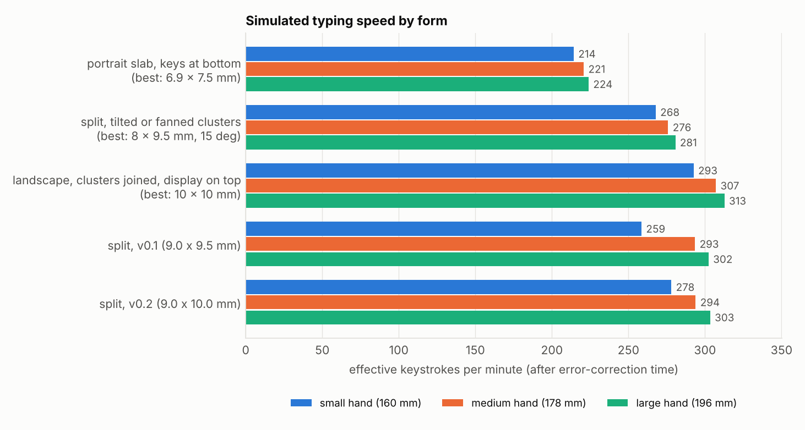
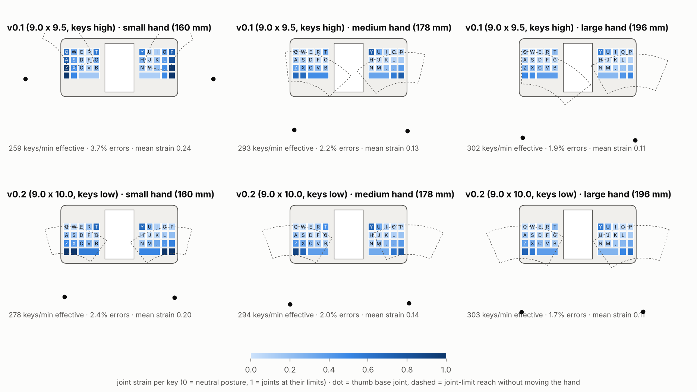
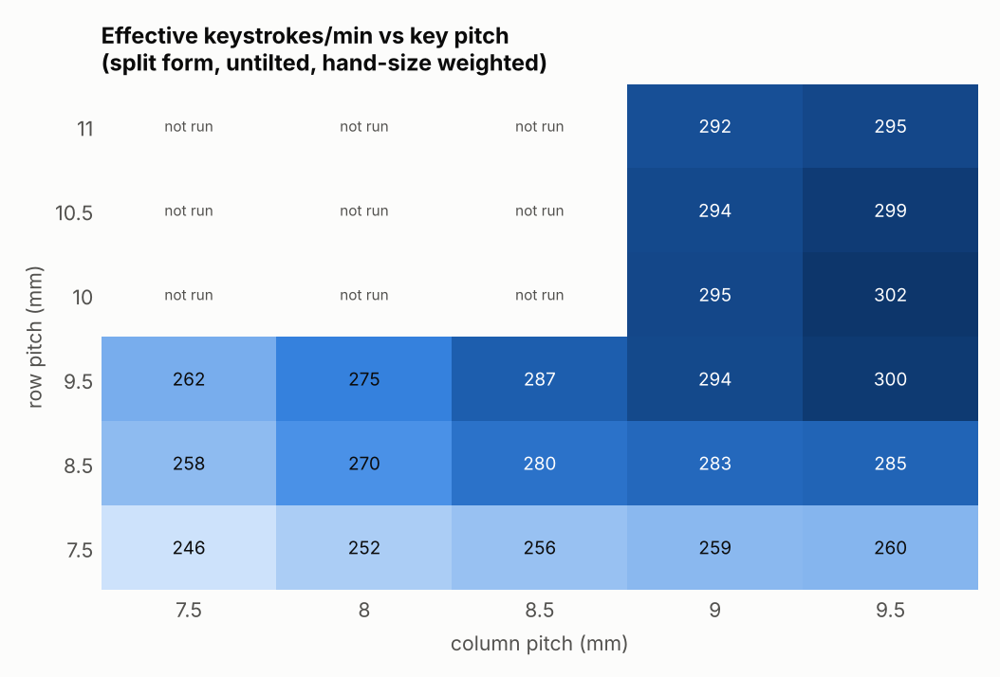

# 타자 시뮬레이션

엄지 관절의 가동범위로 "닿는가, 얼마나 불편한가"를 계산하고, 그 위에 두 엄지 타자 시간·오타 모델을 얹어 형태를 비교했다. 코드는 [`sim/`](../sim)에 있고 아래 수치는 모두 다시 만들 수 있다.

```sh
cd sim
python3 run.py && python3 run.py --refine   # 설계 탐색 (results.json)
python3 sensitivity.py                      # 가정 민감도
python3 figures.py                          # 그림
```

## 1. 결론

1. **키 간격이 가장 큰 변수다.** 간격이 7.5 mm에서 9.5 mm로 커지는 동안 유효 타수가 계속 오르고, 9.0~10.0 mm에서 평탄해진다. 세로형 미니 쿼티(6.9 × 7.5 mm)는 분할형보다 약 25% 느리게 나온다. 오타가 8%로 늘기 때문이다.
2. **키 묶음은 아래쪽이 낫다.** v0.1은 묶음을 본체 위쪽에 뒀는데, 시뮬레이션에서는 반대였다. 묶음 중심을 10 mm 내리면 작은 손의 유효 타수가 259 → 278타/분(+7%)으로 오른다. 자주 쓰는 ⌫·↵가 관절 한계에서 벗어나기 때문이다.
3. **묶음을 기울이거나 부채꼴로 휘는 것은 이득이 없다.** 비교할 수 있었던 간격(7.5 mm)에서 차이가 1% 이내(모델 잡음 수준)인데, 폭을 15~20 mm 더 먹어서 폭 제한 안에서는 키를 줄여야 한다.
4. **어깨(검지) Shift는 엄지 Shift 키보다 약 3% 빠르다.** 쌍자음 비율이 3.5%인 말뭉치 기준이다.
5. **화면 위치는 엄지에게 중요하지 않다.** 좌우 묶음을 붙이고 화면을 위로 올린 형태가 같은 간격에서 분할형과 같은 점수다. 붙인 형태는 화면이 폭을 차지하지 않아 10 × 10 mm 키를 폭 106 mm에 넣을 수 있고, 그만큼(약 4%) 분할 v0.2보다 높게 나온다. → [5절](#5-설계에-반영한-것과-남긴-결정)

이 결과로 설계를 v0.2로 고쳤다: **행 간격 9.5 → 10.0 mm, 키 묶음 10 mm 아래로.**



| 형태 (탐색에서 가장 좋은 설정) | 작은 손 | 중간 손 | 큰 손 | 가중 평균 |
|---|---|---|---|---|
| 세로형, 하단 10열 (6.9 × 7.5 mm) | 214 | 221 | 224 | 220 |
| 분할 + 기울임/부채꼴 (8 × 9.5 mm, 15°) | 268 | 276 | 281 | 275 |
| 분할 v0.1 (9.0 × 9.5 mm, 묶음 위쪽) | 259 | 293 | 302 | 287 |
| **분할 v0.2 (9.0 × 10.0 mm, 묶음 아래쪽)** | **278** | **294** | **303** | **292** |
| 분할, 폭 146 mm 허용 시 (9.5 × 10.0 mm) | 292 | 303 | 308 | 302 |
| 묶음 붙임, 화면 위 (10 × 10 mm, 폭 106 mm) | 293 | 307 | 313 | 305 |

단위는 유효 타/분(오타를 고치는 시간을 뺀 글쇠 수). 가중치는 작은 손 0.25, 중간 0.5, 큰 손 0.25.

절대값은 숙련자의 상한에 가깝다(사용한 시간 모델이 그렇게 만들어졌다). **형태 사이의 상대 비교만 읽어야 한다.** 그립 탐색의 잡음 때문에 1~2% 차이는 구분되지 않는다.

## 2. 모델

### 엄지 ([`sim/thumb.py`](../sim/thumb.py))

- 3마디 링크: 중수골, 첫마디, 끝마디. 길이는 손 길이에 비례한다(0.251, 0.196, 0.158).
- 자유도 4개와 가동범위:

| 관절 운동 | 범위 | 중립 |
|---|---|---|
| CMC 방위 (기기 면 위에서 좌우로 쓸기) | ±26.5° | 0° |
| CMC 들림 (면에서 들어 올리기) | 5° ~ 47° | 25° |
| MCP 굽힘 | 0° ~ 56° | 15° |
| IP 굽힘 | −10° ~ 80° | 20° |

- 엄지 패드가 키 윗면에 닿아야 하고, 끝마디가 면과 이루는 각은 0°~80°여야 한다(그 이상은 손톱으로 누르게 된다). 기기 위에 올라온 관절은 기기를 뚫을 수 없다.
- 키 하나에 닿는 자세는 여러 개이므로 **불편도**(각 관절이 중립에서 한계까지 간 비율의 제곱 평균)가 가장 작은 자세를 고른다.
- 엄지의 굽힘 평면 기울기(회내)는 쥔 자세가 정하는 값으로 보고 손마다 하나를 고른다.
- 손 전체가 기기 위에서 최대 8 mm(중간 손 기준)까지 미끄러져 닿는 범위를 넓힐 수 있고, 그만큼 불편도가 더해진다.

모델에서 나온 중요한 성질: **엄지 끝은 아무리 접어도 뿌리 관절(CMC)에서 손 크기에 따라 59~76 mm 안쪽에는 닿지 않는다.** 손을 움직이지 않고 닿는 영역은 폭 21~33 mm의 띠(아래 그림의 점선)이고, 4행 묶음(키 중심 기준 30 mm)은 작은 손의 띠를 넘는다.

### 그립 ([`sim/model.py`](../sim/model.py))

손마다 CMC 위치, 손 방향, 굽힘 평면 기울기를 탐색해 글쇠 빈도로 가중한 불편도가 가장 작은 그립을 고른다. 타자 중에는 고쳐 쥐지 않는다. CMC는 기기 외곽에서 손 길이의 0.30배까지만 떨어질 수 있다(그보다 멀면 기기를 받칠 수 없다).

### 타자 시간과 오타

- 말뭉치: 메모 문체의 한국어 27문장, 두벌식 글쇠 2,196타 ([`sim/corpus_ko.txt`](../sim/corpus_ko.txt)). 좌우 교대 비율 79%.
- 시간: 두 엄지 타자 모델(MacKenzie & Soukoreff 2002). 같은 엄지의 이동은 Fitts 법칙(176 + 64·log₂(D/W + 1) ms), 반대쪽 엄지가 이어 칠 때는 최소 88 ms.
- 자세의 영향(가정): 이동 시간 × (1 + 0.6·불편도), 착지 산포 × (1 + 0.6·불편도).
- 오타: 엄지 착지점이 표준편차 1.7 mm의 정규분포를 따른다고 보고, 키 간격의 절반을 벗어나면 오타. 오타 하나당 0.7초 + 2타.
- 손 크기: 손 길이 160 / 178 / 196 mm (성인의 대략 5 / 50 / 95 백분위).

### 탐색 범위

| 형태 | 변수 |
|---|---|
| 분할 (화면 중앙) | 열 간격 7.5~9.5, 행 간격 7.5~11, 묶음 세로 위치 −12~+6, 기울임 0/15/30°, 부채꼴 반경 없음/60 mm. 폭 146 mm 이하만 |
| 묶음 붙임 (화면 위) | 열 간격 9~14, 행 간격 8~10, 바닥에서 띄움 0~12 |
| 세로형 | 열 간격 5.5~6.9, 행 간격 5.5~7.5, 바닥에서 띄움 3~18 |

## 3. 닿는 범위와 키별 부담



- 위 줄(v0.1): 작은 손은 옆에서 쥐는 그립밖에 찾지 못하고, 바깥 열의 ⌫·↵와 Q·A·Z가 한계에 걸린다.
- 아래 줄(v0.2): 세 손 크기 모두 **아래에서 받쳐 쥐고 엄지가 거의 위를 향하는** 그립이 최적으로 나온다. 행이 엄지 방향에 수직으로 놓여 4행이 닿는 띠 안에 들어온다. 부담은 드물게 쓰는 맨 아랫행 바깥 키(메뉴, 한/영, ◀, ▶)와 화면 옆 맨 윗칸(T, Y 자리)에 남는다.

## 4. 키 간격



열 간격 9.0 mm 이상, 행 간격 9.5~10.5 mm에서 평탄하다. 행 간격 11 mm부터는 다시 내려간다. 열 간격 9.5 mm는 9.0 mm보다 2~3% 높지만 기기 폭이 147 mm가 되어 스마트폰과 같아진다.

## 5. 설계에 반영한 것과 남긴 결정

**반영 (v0.2)**
- 행 간격 10.0 mm, 키캡 세로 8.4 mm
- 키 묶음을 10 mm 아래로 (윗행 중심 y = +9, 아랫행 y = −21)
- 묶음 기울임·부채꼴 배열은 채택하지 않음

**사용자 결정이 필요한 것**

| 선택지 | 시뮬레이션 | 대가 |
|---|---|---|
| 분할 v0.2 유지 (142 × 70 mm) | 292 | 현재 설계. 세로 화면 240 × 400 |
| 분할, 열 간격 9.5 mm (147 × 70 mm) | 302 (+3%) | 폭이 스마트폰과 같아짐 |
| 묶음 붙임, 화면 위 (약 106 × 92 mm) | 305 (+4%) | 형태가 바뀜. 화면은 가로 400 × 240(한 줄 25자)이 되어 글 읽기에는 오히려 유리. PCB·케이스 재설계 필요 |

차이가 3~4%로 작고 모델의 불확실성(6절)보다 크지 않으므로 현재는 분할형을 유지했다. 케이스가 파라메트릭이므로 0단계 타건 목업에서 분할형과 붙임형을 둘 다 출력해 실측으로 고르는 것을 권한다.

**어깨 버튼 위치 재검토 필요**
최적 그립에서 CMC는 기기 아래 모서리보다 40~60 mm 아래에 있다. 이 자세에서 검지가 윗면 어깨 버튼(높이 70 mm 위)에 닿는지는 이 모델로 확인하지 못했다(검지는 모델에 없다). 작은 손에서는 빠듯할 가능성이 있다. 목업에서 닿지 않으면 버튼을 뒷면(검지가 놓이는 자리)으로 옮긴다.

## 6. 가정을 바꿨을 때

가중 평균 유효 타/분.

| 가정 | 분할 v0.2 | 분할 v0.1 | v0.2 + 엄지 Shift | 붙임 10 × 10 | 세로형 |
|---|---|---|---|---|---|
| 기준 | 292 | 287 | 282 | 305 | 220 |
| 착지 산포 1.3 mm | 322 | 322 | 312 | 327 | 296 |
| 착지 산포 2.1 mm | 234 | 225 | 224 | 251 | 156 |
| 자세가 속도·산포에 영향 없음 | 337 | 335 | 326 | 350 | 246 |
| 자세 영향 2배 | 251 | 244 | 240 | 262 | 197 |
| 손 이동 불가 | 246 | 241 | 251 | 268 | 203 |
| 손 이동 12 mm | 304 | 300 | 294 | 315 | 226 |
| 관절 가동범위 15% 감소 | 277 | 274 | 265 | 287 | 211 |

- 순위(붙임 ≥ 분할 v0.2 ≥ 분할 v0.1 > 세로형)는 대부분의 가정에서 유지된다.
- 착지 산포가 1.3 mm로 작으면 v0.1과 v0.2의 차이가 사라지고 세로형과의 격차도 줄어든다. **키가 얼마나 커야 하는지는 엄지 착지 산포 값에 크게 좌우된다.**
- 손 이동을 전혀 허용하지 않으면 큰 키 형태는 모두 닿지 않는 키가 생긴다(세 손 합계 17~22개). 손이 기기 위에서 조금 미끄러질 수 있다는 가정이 결과를 받치고 있다. 이 경우에는 엄지 Shift가 어깨 Shift보다 높게 나오는데, 닿지 않는 키의 고쳐 쥐기 벌점이 지배하기 때문이다.

## 7. 한계

- **실측이 아니다.** 사람으로 검증하지 않은 모델이다. 0단계 목업에서 분당 타수와 오타율을 재서 착지 산포, 자세 영향 계수, 손 이동 범위를 맞춰야 한다.
- 관절 가동범위와 마디 길이 비율은 문헌의 대표값을 썼고 개인차가 크다. 가동범위는 엄지 단독 측정값이라 기기를 쥔 상태에서는 더 좁을 수 있다.
- 굽힘이 한 평면에서 일어난다고 단순화했다. MCP의 좌우 움직임과 CMC의 축 회전은 뺐다.
- 택타일 키캡의 볼록한 모양이 엄지를 가운데로 이끄는 효과는 없다. 실제 오타율은 모델보다 낮을 가능성이 높고, 작은 키가 덜 불리해질 수 있다.
- 검지(어깨 버튼), 기기를 받치는 안정성, 무게 중심, 두 엄지의 충돌, 피로 누적은 다루지 않았다.
- 말뭉치가 작고(2,196타) 한국어뿐이다. 영문과 숫자·기호 입력은 평가하지 않았다.
- 글자 배열은 두벌식으로 고정했다. 글자 자리를 바꾸는 최적화는 하지 않았다.
